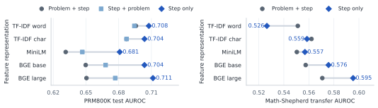

# Pretrained Features for Math-Step Monitoring: Input and Transfer

CSI 436/536, Project P, Midterm, October 20, 2026  
Jiayu Liao, Zeyu Pan, Yuhan Sun

**Question and task.** Do frozen pretrained text features improve a standard classifier, especially with limited labels? We classify math-step correctness with LR or linear SVM, comparing word/character TF-IDF with MiniLM and BGE base/large. Δ = AUROC(embedding) − AUROC(baseline). Each comparison names its input and baseline.

**Data and protocol.** Prepared PRM800K: 911,867 steps, 27.9% incorrect. Problem-grouped split: 632,422 train / 88,872 reserved validation / 190,573 test. C ∈ {0.1, 1, 10} uses grouped CV in train. Encoders are frozen. Original-input learning curves use n = 20, 50, 100, 500, 2000 with ten stratified training subsamples. Full-data/input-ablation conditions use one fit each, seed 0. AUROC is primary, balanced accuracy secondary.

**Current progress.** With problem+step, mean AUROCs are near 0.51 at n=20. From n=50 to 2000, embedding means trail word TF-IDF, with seed-level sign variation. Step-only learning curves remain pending. Removing problem text improves embedding AUROC by 0.050–0.061 versus 0.012–0.016 for TF-IDF. Step-only BGE-large reaches 0.711 versus word TF-IDF 0.708, a +0.0038 point estimate that establishes neither superiority nor equivalence. BGE truncation affects 0.04% of inputs; pooling dilution remains a hypothesis.

For transfer to 613,666 automatically labeled Math-Shepherd/GSM8K steps, step-only BGE-large reaches 0.595 versus word TF-IDF 0.526 (+0.069) and char TF-IDF 0.559 (+0.037). BGE-base also exceeds both, while MiniLM (0.557) trails char TF-IDF. Rule-based perturbations change original-input AUROC by at most 0.007, which does not establish general or step-only robustness.

**Challenges and plans.** An early label-selection bug was corrected before the reported reruns. Input ablation is exploratory and reuses evaluation sets. Current TF-IDF fitting precedes inner CV, requiring a fold-wise preprocessing rerun. Existing paired bootstrap intervals resample steps rather than problems, so we omit significance claims. Next: fold-wise TF-IDF, problem-level paired intervals, step-only learning curves, and separate problem/step encodings. Transfer changes domain, source, and labeling together, limiting causal attribution.

**Takeaway.** Benefit depends on input and baseline. BGE transfer offers the clearest observed gain in this setting, with modest absolute AUROC and confirmatory evaluation still needed.

**Resources.** OpenAI PRM800K, Math-Shepherd, sentence-transformers MiniLM, BAAI BGE-base/large-en-v1.5.

**AI disclosure.** Assistants generated implementation code under group direction and helped check analysis, figures, and rewrite these materials. Group members are responsible for understanding and verifying all submitted content.
